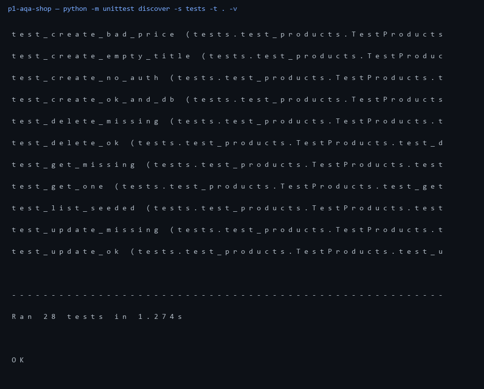

# p1-aqa-shop — автотесты REST API магазина

Проект под вакансию с Хабр Карьеры: **AQA Тестировщик (Python), Junior, удаленно**.
Закрывает навыки из вакансии: Python, ООП, базы данных, REST, SQL, HTTP.

## что внутри

Тестируемое API (`api/`, чистый Python без зависимостей):
- `POST /api/login` — выдача токена, `GET /api/me` — проверка
- `GET/POST /api/products`, `GET/PUT/DELETE /api/products/:id` — CRUD
- `POST /api/orders`, `GET /api/orders` — заказы с расчетом суммы
- валидация: пустой title, цена <= 0, qty не int, битый json
- коды как положено: 200/201/400/401/404

Сьют (`tests/`, unittest, 28 тестов):
- `test_auth.py` — логин ok/401, доступ с плохим токеном и без
- `test_products.py` — сид, CRUD, прямые сверки в sqlite
- `test_orders.py` — расчет total, запись в бд, краевые qty
- `test_misc.py` — health, 404, битый json, Content-Type

## запуск

```bash
python -m unittest discover -s tests -t . -v
```

Сервер для тестов поднимается сам в `setUpClass` (порт 8071, база во временном файле на диске A).
Руками API:

```bash
python -m api.app
# http://127.0.0.1:8071/api/products
```

Зависимостей нет, см. `requirements.txt`. Совместимо и с `pytest`.

## прогон



`Ran 28 tests — OK`
